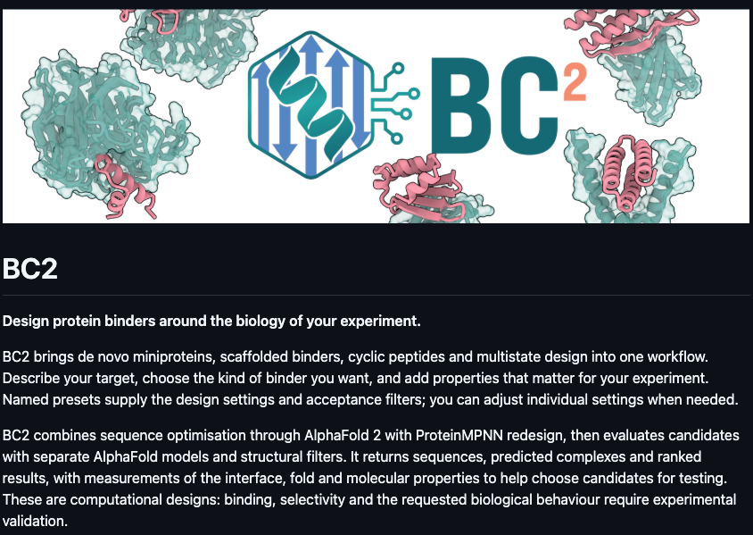
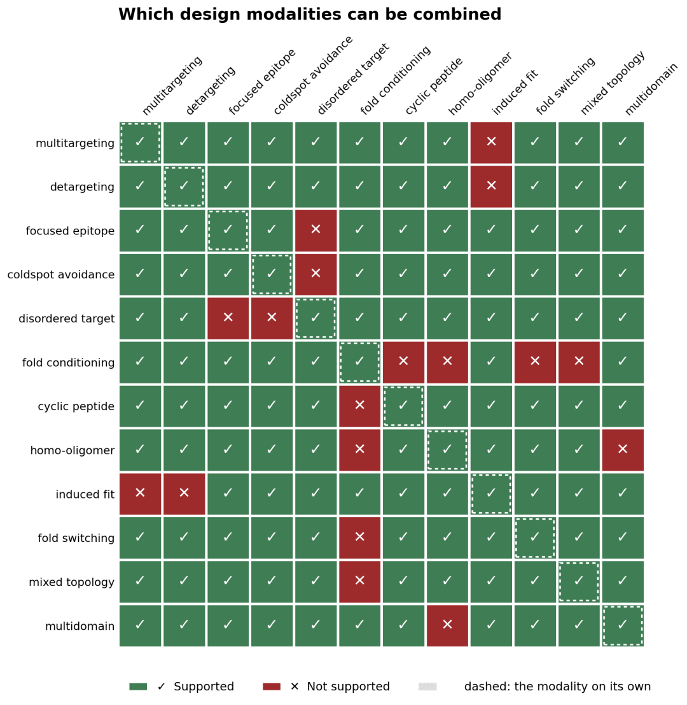

# BindCraft2突然开源：AI蛋白设计开始从"生成结构"走向"设计药物形态"

> **情报编号**：INT-2026-008
> **入库时间**：2026-10-19
> **导师分享时间**：**2026-09-22 04:47（中国时间）** ／ 原始 2026-09-21 21:47（英国时间）
>   ↳ ⚠️ **此条换算存疑**：04:47 是已归档七条中唯一落在凌晨的时间，与导师既有作息（22:51／23:57／11:20／18:23／12:29／22:19／15:14）明显不符。可能原因：① 导师当时在境外；② 本条截图时间并非英国时间。**两个时间都已留档，待本人确认后修正。**
> **推文发布时间**：2026-09-21
> **来源渠道**：微信公众号「LeapFun」——**本知识库第三个信源**（前有 RNAScript ×2）
> **信息提供人**：李晓林教授（AI for Life Science）
> **原始材料**：本人将推文转为 Word 文档提供（含 4 张原文配图），本报告据此整理
> **情报类型**：开源工具发布解读 / AIDD 平台
> **一级标签**：`从头蛋白设计` `BindCraft` `AlphaFold2` `ProteinMPNN` `结合剂` `环肽` `纳米抗体VHH` `抗体设计` `可开发性` `负向设计` `开源许可证`

---

## 0. 一句话结论

> **洛桑联邦理工 Pacesa 实验室发布了 BindCraft2**：第一代（*Nature* 2025）证明了"给一个靶点结构，一轮计算就能设计出能结合的蛋白"；第二代把设计对象从**一条序列**扩展为 **10 种分子形态**（迷你蛋白／线性肽／环肽／VHH／scFv／Fab／ARP／同源寡聚体／多结构域／大蛋白），并把多物种交叉、脱靶排斥、表位控制、构象变化、人源化等**实验约束前移到生成阶段**。
> **本知识库最该记住的一条**：它的核心设计原则是 **"生成者不能自己给自己打满分"**——设计用 AF2 梯度，验证换一个**没参与设计**的 AF2 模型独立复折叠。**这和情报 002 MetaRSI 的"密封验证器"是同一个思想，在蛋白设计领域的独立实现。**
> **两处需要限定**：① **标题的"开源"不准确**——它采用的是 *Source-Available License (Hosting-Restricted)*，官方明确写着"**不是 OSI 认可的开源许可证**"，这一点原文 §8 自己也说了，**是标题与正文打架**；② **新增的 9 种模态尚无湿实验数据**，10%—100% 的成功率是第一代的成绩，预印本仍在准备中。

---

## 0.5 ⭐ 白话导读


*图 1｜BindCraft2 官方项目页。口号是 "Design protein binders around the biology of your experiment."（围绕你这个实验的生物学需求来设计蛋白结合剂）。页面末尾写着："These are computational designs: binding, selectivity and the requested biological behaviour require experimental validation."（这些是计算设计，结合、选择性和所要求的生物学行为都还需要实验验证。）*

### 一、先理解"结合剂"是干什么的

**蛋白质靠"互相抓住"工作。** 比如病毒的刺突蛋白抓住人体细胞表面的受体，就能入侵。如果我们造一个小蛋白，**抢先把病毒的刺突蛋白抓住**，病毒就进不去了——这个"专门去抓某个目标"的分子，就叫**结合剂（binder）**。抗体就是天然的结合剂。

**传统做法**：从几十亿个随机分子里"大海捞针"地筛（噬菌体展示、杂交瘤等），慢、贵、成功率看运气。
**AI 做法**：直接"算"出一个能抓住目标的分子。

### 二、第一代 BindCraft 做了一件很聪明的事

AlphaFold2 原本是**结构预测器**：给它一段序列，它告诉你这段序列会折叠成什么形状。

BindCraft 把它**反过来用**：

```
正着用（AlphaFold2 本职）： 序列  ──→  结构
反着用（BindCraft）：      想要的结构 ──→ 反推序列
```

具体做法是**梯度反向传播**——先随便给一条序列，让 AF2 预测它和靶点结合得怎么样，然后顺着"哪里改一改会更好"的方向一点点改序列，反复迭代。这在机器学习里是训练模型的标准手段，BindCraft 把它用来**改分子**。

> 📌 **这一招的名字叫"反向设计"（inverse design）**，是 AI for Science 里非常通用的思路：把一个"预测器"当成"优化器"用。

### 三、第二代改了什么——一个类比

| | 第一代 BindCraft | 第二代 BindCraft2 |
|---|---|---|
| 你告诉它 | "帮我设计一个能抓住 X 的蛋白" | "帮我设计一个**环肽**，能同时抓住**人和小鼠**的 X，**不要**抓住长得很像的 Y，**只能**抓 X 的这一面，而且要**像人的蛋白**、**不容易被酶切**" |
| 像什么 | 点一道菜 | 点一桌菜，还要说清忌口、过敏、预算和上菜顺序 |

**真正的变化**：AI 蛋白设计的"单位"，从**一条序列**变成了**一种药物形态**。

### 四、10 种分子形态是什么

| 形态 | 白话 | 大概多大 |
|---|---|---|
| **迷你蛋白**（de novo binder） | 从零设计的小蛋白 | 50–150 个氨基酸 |
| **大蛋白**（large binder） | 同上，但更大 | 300+ |
| **线性肽**（linear peptide） | 一小段直链短肽 | <25 |
| **环肽**（cyclic peptide） | 首尾连成一个圈的短肽，更稳定 | <25 |
| **同源寡聚体**（homo-oligomer） | 几个一模一样的亚基拼成的复合体 | — |
| **多结构域**（multidomain） | 几个功能块串起来 | — |
| **VHH／纳米抗体** | 羊驼来源的超小抗体，只有一个结构域 | ~120 |
| **ARP** | ankyrin repeat 支架，一种非抗体骨架 | — |
| **scFv** | 抗体的两个可变区用链子连起来 | ~250 |
| **Fab** | 抗体的一整个"手臂" | ~450 |

> 💡 **为什么要分这么多种？** 因为药物形态决定了它能干什么：环肽能口服、能钻进细胞；纳米抗体能钻进组织深处（见情报 006 的 P4107 就用了 VHH）；Fab 更接近成熟抗体药。**同一个靶点，选哪种形态是药物开发的核心决策之一**，过去要用完全不同的工具分别做。

### 五、几个关键名词

| 术语 | 白话解释 |
|---|---|
| **表位**（epitope） | 靶点蛋白上被抓住的**那一小块地方**。同一个蛋白不同位置被抓，效果完全不同 |
| **hotspot / coldspot** | 热点＝"我希望你抓这儿"；冷点＝"这块别碰" |
| **脱靶**（off-target） | 本来想抓 A，结果把长得像的 B 也抓了——副作用的主要来源 |
| **负向设计**（detargeting） | 主动告诉系统"**不要**抓住这个"。比"抓住"更难 |
| **物种交叉反应** | 同一个分子在人和小鼠身上都管用。**没有这个就没法做动物实验** |
| **可开发性**（developability） | 能不能被量产：好不好表达、会不会结团、稳不稳定 |
| **人源化**（humanization） | 让分子看起来更"像人自己的蛋白"，减少免疫排斥 |
| **诱导契合 / 折叠转换** | 分子结合前后会变形。前者是局部微调，后者是大改 |
| **pLDDT / i_pTM / PAE / i_pDAE** | AlphaFold 给出的**置信度**分数——"我对这个预测有多确定"。**注意：这不是结合强度** |

### 六、全文最重要的一句话

> **"生成结果不能直接用生成过程中的分数自证成功。"**

打个比方：**学生不能自己批自己的卷子。** BindCraft2 用 AF2 的梯度"写答案"，但批卷子时换一个**没参与写答案**的 AF2 模型重新算一遍。这就是本知识库反复提到的"验证器"问题（见 §6.2）。

---

## 1. 情报元信息

| 项目 | 内容 |
|---|---|
| 工具 | **BindCraft2（BC2）** |
| 代码仓库 | <https://github.com/PacesaLab/BindCraft2> ✅ 已直连核实 |
| 开发方 | **Pacesa Lab**（Martin Pacesa，原工作在 EPFL Correia Lab × MIT Ovchinnikov Lab 合作下完成） |
| 第一代论文 | *One-shot design of functional protein binders with BindCraft*，**Nature** 646(8084):483–492，**在线 2025-08-27／期刊 2025-10-09**，DOI [10.1038/s41586-025-09429-6](https://www.nature.com/articles/s41586-025-09429-6) ✅ |
| BindCraft2 论文 | ❌ **尚无预印本**。Pacesa Lab 官网标注"Preprint coming soon／in preparation" |
| 许可证 | **BindCraft2 Source-Available License (Hosting-Restricted)** ✅ 已直连核实原文 |
| 底层依赖 | AlphaFold2（Apache 2.0）、ColabDesign、ProteinMPNN（MIT）、HyperMPNN ✅ |

> ✅ **本篇核查条件较好**：github.com 与 raw.githubusercontent.com 在本环境可直连，**BindCraft2 的 README 与 LICENSE 原文均已逐字核实**。nature.com、arxiv.org、pacesalab.com 被网络策略拦截，相关数据来自检索摘录与二手报道，已逐条标注。

---

## 2. 全文骨架拆解

```
①  开篇：设计的"单位"正在从一条序列 → 一种药物形态
        ↓
②  §1 第一代做了什么：把 AF2 从预测器反转为优化器，one-shot 拿到纳摩尔结合剂
        ↓
③  §2 第二代的本质：不是加参数，而是重做任务边界 → 分层配置系统
        ↓
④  §3 覆盖 10 类结合剂 + 兼容矩阵（哪些能叠加，哪些冲突）
        ↓
⑤  §4 真正难的：多靶点共识别 / 脱靶排斥 / 表位控制 / 构象设计
        ↓
⑥  §5 可开发性前移（人源化、蛋白酶稳定、二硫键……）——但代理指标 ≠ 药物性质
        ↓
⑦  §6 如何工作：AF2梯度 → ProteinMPNN重设计 → 独立复折叠 → 过滤排名
        ↓                   ⭐ 核心原则：生成者不能自证
⑧  §7 与 RFdiffusion / AlphaProteo / Chai-2 的区别
        ↓
⑨  §8 四个边界（罕见的诚实章节）
        ↓
⑩  §9 判断：竞争从"生成漂亮结构" → "组织闭环"
```

---

## 3. 逐项核查

**判定标准**：✅ 属实　⚠️ 部分属实／需限定　❌ 不成立

| # | 原文说法 | 判定 | 核查结果 |
|---|---|---|---|
| 1 | 标题："BindCraft2**突然开源**" | ⚠️ **"开源"用词不准** | 许可证原文：*"This license is not the standard MIT License and is **not an Open Source Initiative approved open source license**."* 准确说法是**源码可得（source-available）**。**原文 §8 第 4 条自己说清楚了，是标题与正文打架** |
| 2 | 第一代 2025 年发表于 *Nature* | ✅ | Nature 646(8084):483–492，在线 2025-08-27 |
| 3 | 把 AF2 从结构预测器反转为序列优化器（梯度反传） | ✅ | GitHub README：*"BC2 combines sequence optimisation through AlphaFold 2 with ProteinMPNN redesign"* |
| 4 | 实验成功率 **10%—100%** | ✅ **但原文漏了一个更有用的数** | 论文在 **12 个靶点**上基准测试，**平均成功率 46.3%**，区间 10%–100%。**汇报时报"12 靶点、平均 46.3%"比报区间更有说服力** |
| 5 | 可不做高通量筛选获得纳摩尔级结合剂 | ✅ | 论文摘要 |
| 6 | 官方口号 "Design protein binders around the biology of your experiment." | ✅ | GitHub README 逐字一致 |
| 7 | 覆盖 **10 类**结合剂 | ✅ | README 列出：de novo binder、large binder、linear peptide、cyclic peptide、homo-oligomer、multidomain、VHH、ARP、scFv、Fab——**10 类全部对上** |
| 8 | 分层配置 core / modality / property / target / campaign | ✅ **实际是 6 层** | README 的层级为 core → **core profile** → modality → property → target → campaign，后者覆盖前者。原文漏了 core profile 一层 |
| 9 | 构象设计：induced fit / fold switch | ✅ | README 列为 "Conformational design" |
| 10 | "lysine trick"：临时把暴露残基换成赖氨酸以强制表位 | 🟡 **未独立核实** | GitHub 主页未见此描述，可能在文档子页。**汇报时建议略过或标注待核** |
| 11 | 独立复折叠由**未参与设计**的 AF2 模型完成 | ✅ | README：*"evaluates candidates with **separate** AlphaFold models and structural filters"* |
| 12 | AlphaProteo：7 个靶点、3—300 倍亲和力提升 | ⚠️ **数字对，但 300 倍是上限** | 7 靶点属实；3–300× 属实；但 **DeepMind 官方博客自己给的是"平均约 10 倍"**；实验成功率 9%–88% |
| 13 | Chai-2：zero-shot 实验命中 | ✅ | 52 个 PDB 中无已知结合剂的新靶点，**de novo 抗体命中率约 16%**，较此前方法高 100 倍以上（2025 年中发布） |
| 14 | 尚无新增模态的系统湿实验基准 | ✅ **且更严重** | 不仅没有湿实验基准，**连预印本都还没有**（Pacesa Lab 官网："Preprint coming soon"） |
| 15 | 置信度不是亲和力（i_pTM/pLDDT ≠ Kd） | ✅ | GitHub README 独立确认：*"confidence scores are not binding affinities"* |
| 16 | 许可证：允许学术界、Biotech、药企免费内部使用，限制第三方托管/SaaS | ✅ **完全准确** | 许可证原文：内部商业使用免费；作为 hosted/cloud/API/SaaS 提供给第三方需单独商业许可；**把"作为可调用工具、插件、agent action、connector"提供给第三方也算托管服务** |

> 📌 **一处编号笔误**：原文有**两张图都标作"图2"**（Nature 论文工作流图、模态兼容矩阵）。本知识库存档时已改为图 1–4 并逐张加注。

### 3.1 模态兼容矩阵——这张图是全文最有信息量的部分


*图 4｜BindCraft2 官方模态兼容矩阵（Which design modalities can be combined）。绿色＝支持组合，红色＝不支持或逻辑冲突，虚线框＝该模态单独使用。*

从图中可直接读出的冲突（这些是**系统在启动前就会拒绝**的组合）：

| 冲突对 | 为什么冲突（推测，原文未解释） |
|---|---|
| **multitargeting × induced fit** | 要求同一分子对多个靶点都诱导出特定构象变化，约束互相打架 |
| **detargeting × induced fit** | 同上，负向设计与构象设计难以同时满足 |
| **multitargeting / detargeting × homo-oligomer** | 寡聚体的对称性约束与多靶点/脱靶约束冲突 |
| **focused epitope / coldspot × disordered target** | 无序靶点没有稳定结构，谈不上"指定表位" |
| **fold conditioning × cyclic peptide / homo-oligomer / induced fit / fold switching** | 折叠已被固定，就不能再要求环化几何或折叠改变 |
| **homo-oligomer × multidomain** | 对称复合体与多结构域串联的拓扑互斥 |

> 💡 **把"做不到什么"显式画出来，本身是一种值得学习的工程诚实。** 多数 AI for Science 工具只宣传能力边界的上沿。

---

## 4. 关键术语解构表

| 术语 | 英文 | 技术含义 | 在本文中的作用 |
|---|---|---|---|
| 反向设计 | inverse design | 把预测模型当优化器用，沿梯度反推输入 | BindCraft 的核心机制 |
| 幻觉设计 | hallucination | 让结构预测模型"想象"出一个符合目标的结构 | ColabDesign 框架的基础 |
| 骨架 | backbone | 蛋白的主链三维走向，不含侧链 | ProteinMPNN 在骨架上重设计序列 |
| 序列重设计 | sequence redesign | 给定骨架，重新挑选每个位置的氨基酸 | 减少对 AF2 梯度偶然模式的依赖 |
| 独立复折叠 | independent refolding | 换一个未参与设计的模型重新预测结构 | **验证器与生成器分离** |
| 负向设计 | negative design / detargeting | 主动要求"不要结合某个蛋白" | 选择性的来源 |
| 诱导契合 | induced fit | 结合前后发生局部构象调整 | 状态依赖设计 |
| 折叠转换 | fold switch | 同一序列在不同条件下折叠成不同结构 | 更大尺度的状态设计 |
| 代理指标 | proxy metric | 用易算的量近似难测的性质 | 人源化分数 ≠ 免疫原性 |
| 源码可得 | source-available | 代码公开可读，但不满足开源定义 | **本篇的许可证类型** |

---

## 5. 批判性解读

### 5.1 这篇推文的质量明显高于前几篇

| 对比 | 情报 005（AnewDDE） | 情报 006（艾博 Cell） | **本篇（BindCraft2）** |
|---|---|---|---|
| 标题 | "超越 IsoDDE、超越 FEP+" | "首次人体验证" | "突然开源" |
| 标题问题 | 夸大对比 | **事实错误**（有更早先例） | **用词不准**（source-available ≠ open source） |
| 正文 | 八处"但是" | 未提先例 | **专设 §8"必须说清楚的四个边界"** |
| 自我纠正 | 部分 | 无 | **§8 第 4 条自己纠正了标题** |

> **结论**：LeapFun 这篇**正文严谨度在本知识库已归档的三个信源中最高**，但仍遵循"标题强于事实"的公众号通例。**知识库洞察 21 的判断继续成立，只是本篇的失真程度最轻，且可被正文自纠。**

### 5.2 真正的局限（原文已说，但值得放大）

| 局限 | 原文说法 | 为什么重要 |
|---|---|---|
| **新模态零湿实验** | "尚无新增模态的系统湿实验基准" | 10 类模态里，**只有 de novo binder 有 Nature 级验证**，其余 9 类是**工程能力声明**，不是性能声明 |
| **置信度 ≠ 亲和力** | "i_pTM、i_pDAE、pLDDT 和 PAE 不是 Kd、kon 或 koff" | 见 §6.3，这是本知识库洞察 15 的第四次独立印证 |
| **验证器与生成器同源** | "设计与验证仍属于 AlphaFold 模型家族" | **换一个 AF2 ≠ 换一个独立观点**，共享架构与训练数据的系统性偏差消不掉 |
| **裁剪结构造假表位** | "细胞表面靶点还要放回完整受体、膜、天然复合体和糖基化背景" | 计算上成立的表位，在真实细胞膜环境里可能根本够不着 |

### 5.3 原文没说的两点

1. **脱靶排斥只覆盖"你想到的"脱靶**。原文提了"不能证明全蛋白组选择性"，但没说清后果：**人体约 2 万种蛋白，detarget 一次只能排除你明确输入的那几个。** 真正的安全性仍要靠实验的全蛋白组筛选。
2. **计算成本未披露**。10 类模态中 Fab（~450 aa）、large binder（300+ aa）的 AF2 梯度优化成本远高于迷你蛋白，但原文与 README 都未给出 GPU 时长量级。**这直接决定课题组能不能用。**

### 5.4 用知识库检查清单（洞察 18 + 21 + 洞察 23）过一遍

| # | 问题 | 本篇答案 |
|---|---|---|
| 1 | 领先多少？ | **未声称领先**——原文明说"没有证明在所有任务上超过 RFdiffusion、AlphaProteo 或 Chai-2" ✅ 难得 |
| 2 | 对手都参赛了吗？ | 不适用（无横向基准） |
| 3 | 计算指标还是实验指标？ | **新模态：纯计算**；第一代：实验 |
| 4 | 赢的是排序还是定量？ | 排序（置信度过滤 + i_pDAE 排名） |
| 5 | 速度对比同条件吗？ | 未给计算成本 |
| 6 | 绝对水平够用吗？ | 第一代平均 46.3% 命中率足够；新模态未知 |
| 7 | 内部基准还是公认基准？ | 新模态**无基准** |
| 8 | 单点验证还是端到端？ | 工程上端到端，**验证上是单点（仅 de novo binder）** |
| 9 | 这个"首次"有没有先例？ | 未声称首次 ✅ |
| 10 | **这几个成果是同一个系统做出来的吗？** | ⚠️ **不是**——10%—100% 属于**第一代**，不能挂到第二代的 10 类模态头上。**原文 §8 第 1 条已明确防住这个误读** |

---

## 6. 对课题组的关联分析与可行切入点

### 6.1 与导师研究方向的对应关系

导师档案 §3 的方向 ②（AIDD 智能药物设计）明确列出：**小分子、肿瘤疫苗、新抗原、多肽、抗体、核酸药物**。

| 导师方向关键词 | BindCraft2 对应模态 |
|---|---|
| **多肽** | linear peptide、cyclic peptide |
| **抗体** | VHH、scFv、Fab |
| 新抗原 / 肿瘤疫苗 | 间接相关（表位控制、MHC-II 锚定代理量） |

> **BindCraft2 用一套系统覆盖了导师方向 ② 的"多肽 + 抗体"两大块**，而且是**可本地部署、内部商用免费**的。这大概率是导师转发的原因。

### 6.2 ⭐⭐ 最重要的关联：验证器与生成器必须分离——第三次独立出现

| 情报 | 领域 | 验证器的实现 | 原话 |
|---|---|---|---|
| **002 MetaRSI** | AI 架构 | **密封验证器**（sealed verifier） | 定律一：循环只在**可机器验证**处闭合 |
| **CHK-001 谷歌湿实验室** | 分子发现 | 测序读出命中率；**对照筛选**暴露假阳性 | 第二轮特异性崩塌正是因为缺对照 |
| **008 BindCraft2** | 蛋白设计 | **独立复折叠**：换一个未参与设计的 AF2 | **"生成结果不能直接用生成过程中的分数自证成功"** |

> **三个完全不同的领域、三套语言，收敛到同一条工程原则：生成器不能当自己的裁判。**
> 而 BindCraft2 还往前走了一步，**诚实指出自己这个原则执行得不彻底**——"设计与验证仍属于 AlphaFold 模型家族，无法完全消除同源架构与训练数据带来的系统性偏差"。
> 👉 **这给课题组留下一个可直接立项的问题：如何构造一个与生成器架构独立的验证器？** 这正是洞察 9（评估体系是瓶颈）从"判断"变成"具体课题"的落点。

### 6.3 "排序强定量弱"第四次独立印证

| 情报 | 排序指标（赢） | 定量指标（输/缺） |
|---|---|---|
| 001 综述 | scFM 成功案例全是排序任务 | 扰动预测未赢线性模型 |
| 003 State（Cell） | 斯皮尔曼 0.9 | MAE 输给朴素基线 |
| 005 AnewDDE | Spearman 0.724 赢 Boltz-2 | ΔΔG RMSE 1.057 输给 1.016 |
| **008 BindCraft2** | i_pTM / i_pDAE / pLDDT **用于过滤与排名** | **原文明说：这些不是 Kd、kon、koff** |

> **洞察 15 的模式在第四个子领域复现。这已经可以当作前提使用，不需要再论证。**

### 6.4 可行切入点

| 切入点 | 具体做法 | 难度 | 为什么可行 |
|---|---|---|---|
| **A. 先跑通，建立基线** | 用 BindCraft2 对课题组已有靶点生成候选，与文献已知结合剂对比 | 🟢 低 | 内部使用免费、可本地部署、有 Colab notebook |
| **B. ⭐ 独立验证器研究** | 用**非 AlphaFold 架构**（如 ESM 系、Boltz 系）做第三方复折叠，量化 BindCraft2 自评分的乐观偏差 | 🟡 中 | **直击原文承认的局限**；与洞察 9 的主线完全吻合；不需要湿实验即可出结果 |
| **C. 新模态的计算基准** | 为 9 个无基准的新模态建立**计算层面**的横向评测 | 🟡 中 | 填补原文 §8 第 1 条的空白；是"评估体系"方向的具体产出 |
| **D. 与课题组单细胞主线结合** | 用单细胞/空间组学数据选靶（哪个蛋白在哪类细胞高表达）→ BindCraft2 设计结合剂 | 🔴 高 | 把课题组的**数据优势**接到**设计工具**上；但需要湿实验配合 |

> 💡 **推荐 B。** 理由：① 不需要湿实验，纯计算即可完成；② 直接回答一个工具作者自己承认但没解决的问题；③ 与知识库洞察 9（评估体系是瓶颈）、洞察 17（模型指标→真实产出的换算关系缺失）是同一条线；④ 成果形式天然适合 npj 系列（见情报 007）。

### 6.5 使用前必须注意的许可证问题

| 场景 | 是否需要单独商业许可 |
|---|---|
| 课题组内部研究使用 | ❌ 不需要 |
| 药企内部药物发现 | ❌ 不需要 |
| 发表论文、公开设计结果（序列/结构） | ❌ 不需要（许可证明确：设计产出不算 Hosted Service） |
| **搭一个网页服务让别人在线跑** | ✅ **需要** |
| **包装成 API / 插件 / agent 工具给第三方调用** | ✅ **需要**（许可证把这种情况明确算作托管服务） |

> ⚠️ **如果课题组考虑把它接入自建平台或 LangGraph 类工作流并对外提供**，这一条必须先看清楚。

---

## 7. 待追踪清单

- [ ] **确认导师分享时间**：04:47（中国时间）存疑，见报告头
- [ ] BindCraft2 预印本发布后，核实：新模态的湿实验命中率、各模态计算成本、lysine trick 的具体实现
- [ ] 跑一次 BindCraft2，记录 GPU 时长与显存需求（判断课题组可行性）
- [ ] 核实 "lysine trick" 的出处（GitHub 文档子页或预印本）
- [ ] 对比 BindCraft2 与 Chai-2、AlphaProteo 在**同一靶点**上的表现（注意：跨论文比成功率不成立，需自建对照）
- [ ] 关注 Pacesa Lab 是否补充全蛋白组选择性评估模块

---

## 8. 来源清单

**已直连核实**

- BindCraft2 代码仓库：<https://github.com/PacesaLab/BindCraft2>（README 逐字核实）
- BindCraft2 许可证：<https://raw.githubusercontent.com/PacesaLab/BindCraft2/main/LICENSE>（全文核实）

**检索摘录（本环境无法直连）**

- BindCraft 第一代（*Nature*）：<https://www.nature.com/articles/s41586-025-09429-6>
- 第一代预印本：<https://www.biorxiv.org/content/10.1101/2024.09.30.615802v1>
- Pacesa Lab 官网：<https://www.pacesalab.com/bindcraft>（"Preprint coming soon"）
- Colab notebook：<https://colab.research.google.com/github/PacesaLab/BindCraft2/blob/main/bindcraft.ipynb>
- AlphaProteo（DeepMind 博客）：<https://deepmind.google/blog/alphaproteo-generates-novel-proteins-for-biology-and-health-research/>
- Chai-2 预印本：<https://www.biorxiv.org/content/10.1101/2025.07.05.663018.full.pdf>

---

*入库于 2026-10-19 · 原文存档见 [原文存档.md](./原文存档.md)*
