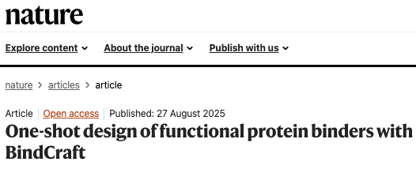
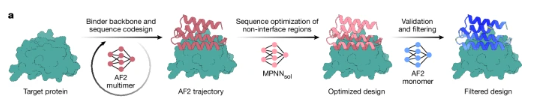

# BindCraft2突然开源：AI蛋白设计开始从"生成结构"走向"设计药物形态"

> **来源**：微信公众号「LeapFun」
> **作者**：LeapFun
> **发布时间**：2026-09-21
> **原文链接**：<https://mp.weixin.qq.com/s/qGe3kPPMoXMv42HRzayMtg>
> **存档方式**：本人将推文转为 Word 文档提供，由 Claude 解包后忠实还原（含 4 张原文配图）
> **存档原则**：**一字不改**。原文的标点、表述、编号（包括两处都标作"图2"的笔误）全部按原样保留。

---

图1｜BindCraft2官方项目。来源：Pacesa Lab / BindCraft2 GitHub

如果说第一代BindCraft解决的问题是：能不能只给一个靶点结构，就从零设计出真正能够结合它的蛋白？

那么刚刚公开的BindCraft2，问的是一个更接近真实药物研发的问题：

你想设计哪一种结合剂，它还必须满足什么生物学条件？

它可以是迷你蛋白、线性肽、环肽、VHH、scFv、Fab、ankyrin repeat protein，也可以是多结构域蛋白和同源寡聚体；它可以同时识别人和小鼠的同源靶点，也可以被要求避开一个高度相似的脱靶蛋白；它可以被引导到特定表位，还可以加入人源化、蛋白酶稳定性、二硫键、末端可及性和结合前后构象变化等约束。

过去，这些需求通常分散在不同模型、不同脚本和不同团队中。BindCraft2最重要的贡献，是试图把它们放进同一个设计系统。

AI蛋白设计的单位，正在从一条序列，升级成一种实验与药物形态。

---

## 一、第一代BindCraft，为什么已经足够重要？

2025年，BindCraft正式发表于《Nature》。它把AlphaFold2从"结构预测器"反过来变成了"序列优化器"。

传统结构预测是"给定序列，预测结构"；BindCraft则沿着AlphaFold2的梯度反向传播，不断修改结合剂序列，使模型预测出的靶点—结合剂复合物具有更好的折叠、界面与接触。

生成候选后，ProteinMPNN围绕骨架重新设计序列，独立的AlphaFold模型再从头复折叠和筛选。最终输出的是可以合成并送入实验的候选序列。

第一代论文报告，在测试的多个靶点上，实验成功率达到10%—100%，并且可以在不做传统高通量筛选和多轮实验优化的情况下获得纳摩尔级结合剂。

这也是"one-shot design"真正有分量的地方：不是计算只生成一个序列，而是经过一轮计算设计，第一轮实验就有机会拿到功能性分子。

BindCraft 1完成了三项重要贡献：

证明AlphaFold2不仅能预测天然蛋白，也能通过梯度反传参与从头设计；

把生成、ProteinMPNN重设计、独立复折叠和结构过滤连成自动化流程；

用湿实验说明低通量、接近"一轮式"的binder设计也能获得很高命中率。

但第一代的核心对象仍以de novo蛋白结合剂为主。真正进入药物研发之后，团队关心的不只是"能不能结合"，还包括分子形态、表位、物种交叉反应、脱靶、表达、稳定性与功能机制。

图2:"AF2梯度设计—ProteinMPNN—独立复折叠—实验验证"。原图来自"Pacesa et al., Nature, 2025"。链接：https://www.nature.com/articles/s41586-025-09429-6

---

## 二、BindCraft2不是BindCraft 1加几个参数，而是重做了任务边界

BindCraft2的官方口号是：

Design protein binders around the biology of your experiment.

也就是：围绕实验的生物学需求设计蛋白结合剂。

在第一代中，最核心的输入是靶点结构与结合区域；到了BindCraft2，用户可以同时定义：采用哪种分子形态、结合哪个靶点和表位、避免哪些区域、是否识别多个同源靶点、是否排斥指定off-target、需要哪些属性，以及最终如何验证、过滤和排名。

它把这些需求组织成分层配置：core负责基础设置，modality负责分子形态，property负责额外属性，target负责具体靶点和表位，campaign保存项目级目标。

这看起来像软件工程，但对产业非常重要。真正的药物设计不是调用一次模型，而是管理一整套不断变化、彼此冲突的约束。

BindCraft2的关键价值，是把"生物学意图"转成可组合、可追踪的计算条件。

---

## 三、一套系统覆盖10类结合剂

| 设计模态 | 解决的问题 | 与普通de novo小蛋白的差别 |
|---|---|---|
| De novo binder | 从零设计独立折叠的结合蛋白 | 第一代BindCraft的核心能力 |
| Large binder | 设计超过300 aa的结合剂 | 更高计算成本和更复杂折叠空间 |
| Linear peptide | 设计25 aa以下短肽 | 可能在结合后才形成稳定构象 |
| Cyclic peptide | 设计头尾环化短肽 | 必须满足闭环几何和构象约束 |
| Homo-oligomer | 设计相同亚基复合体 | 同时处理对称性和靶点结合 |
| Multidomain | 多结构域串联结合剂 | 处理结构域相对构象和linker |
| VHH | 单域抗体框架设计 | 保留框架并设计CDR与暴露面 |
| ARP | ankyrin repeat支架结合剂 | 支架化设计而非完全从零生成 |
| scFv | VH与VL可变结构域 | 当前按两条链建模，linker另行设计 |
| Fab | 重链与轻链组成的片段 | 包含可变区和恒定区，层级更复杂 |

不同模态不是把序列简单拉长或缩短，而是调用不同支架、可设计区域、模型策略和接受阈值。团队可以围绕同一靶点，在同一结果体系下比较迷你蛋白、环肽、VHH和Fab等不同形式。

图2｜BindCraft2官方模态兼容矩阵。绿色代表可以组合，红色代表当前不支持或逻辑冲突

这张图也说明：不是所有目标都能随意叠加。某些模态和性质可以组合，某些会彼此矛盾，系统会在启动前拒绝。它没有假装"所有功能都能一键实现"，而是把边界显式暴露出来。

---

## 四、真正难的不是结合，而是选择性与状态

BindCraft2开始系统处理四类问题：

**1. 多靶点共同识别**

例如同时输入人PD-L1和小鼠PD-L1，让同一结合剂在两个物种上都保留结合能力。这对动物药效和临床转化很有价值。

**2. 指定脱靶排斥**

用户可以把某个结构设为detarget，设计过程轮换评估目标与脱靶状态，压低对off-target的接触和界面置信度。但它只能规避明确提供的蛋白，不能证明全蛋白组选择性。

**3. 表位控制**

hotspot告诉系统希望结合哪里，coldspot保护不希望占据的区域。forced targeting还采用"lysine trick"：早期临时把热点保护壳之外的暴露残基换成赖氨酸，迫使结合剂把界面集中到目标表位，之后再恢复真实靶点验证。

**4. 构象设计**

induced fit追求游离态和结合态之间的局部界面变化；fold switch追求更大尺度的折叠改变。这已经从静态"钥匙—锁"匹配迈向状态依赖设计。

不过，预测到两种构象不等于实验上证明构象切换，更不等于已经确定切换动力学与热力学。这里目前仍属于计算假设生成。

---

## 五、可开发性被前移，但代理指标不是药物性质

BindCraft2把一部分实验需求前移到生成阶段：

Humanization：偏向更具人源特征的序列，并降低MHC-II锚定评分代理量；

Protease stable：降低预测切割倾向，减少暴露柔性环和末端；

Disulfide staple：加入几何兼容的二硫键；

Mixed topology：避免设计全部坍缩成高α螺旋小蛋白；

Termini together：让N端和C端靠近，支持环化或特定构建；

Termini accessible：让两端朝向溶剂，方便融合、标记或偶联。

它真正重要的思想是：实验要求不再只是生成后的过滤器，而开始参与生成目标。

但humanization不等于低免疫原性；蛋白酶评分不等于血清半衰期；结构置信度也不等于高表达、低聚集、低黏度和良好制剂稳定性。准确地说，它把部分"可开发性意识"带入了早期设计，而不是已经解决了可开发性。

---

## 六、它如何工作：生成者不能自己给自己打满分

AlphaFold梯度轨迹：共同探索序列、折叠和结合姿态，经过screen、refine、anneal、harden和mutate，低质量轨迹提前淘汰。

ProteinMPNN重设计：围绕生成骨架采样新序列，减少对AF2梯度优化中偶然序列模式的依赖。

独立复折叠：由未参与设计的AlphaFold模型从头预测，没有梯度"推着模型给出想要的答案"。

过滤与排名：候选通过界面、折叠、几何、接触和分子属性条件，再用i_pDAE等指标排序。

最值得AI药研团队借鉴的原则是：生成结果不能直接用生成过程中的分数自证成功。

但设计与验证仍属于AlphaFold模型家族，无法完全消除同源架构与训练数据带来的系统性偏差。因此它是更严格的计算复核，不是独立实验验证。

---

## 七、与BindCraft 1及其他模型的贡献和区别

| 方法 | 核心路线 | 主要贡献 | 强项 | 与BindCraft2的本质区别 |
|---|---|---|---|---|
| RFdiffusion | 扩散去噪生成蛋白骨架，再进行序列设计与结构验证 | 把扩散模型带入三维蛋白生成，提升新骨架和几何条件生成能力 | 骨架多样性、结构条件生成 | 更像强大的结构生成引擎；BindCraft2更像多模态设计与筛选平台 |
| BindCraft 1 | 对AF2反向传播，直接优化结合剂序列和复合物 | 证明AF2可用于one-shot binder设计，并建立高命中率开源流程 | 低实验筛选量、操作直接、可本地运行 | BindCraft2继承核心引擎，同时扩展支架、环肽、多目标、脱靶、多状态和属性约束 |
| AlphaProteo | DeepMind端到端binder生成体系 | 在7个靶点上报告更高实验成功率和3—300倍亲和力提升 | 高亲和力与实验表现 | 强项是新模型能力；BindCraft2强调公开运行、细粒度控制与多模态工作流，不应跨论文简单比成功率 |
| Chai-2 | 联合序列—全原子结构生成 | 把生成范围推向抗体及更复杂药物样分子，强调zero-shot实验命中 | 抗体、复杂模态、序列结构协同 | 更像新一代基础生成模型；BindCraft2是AF2＋ProteinMPNN驱动的可配置、可审计流程 |
| BindCraft2 | AF2梯度优化＋ProteinMPNN＋独立AF2复折叠＋预设系统 | 统一10类结合剂、多靶点、脱靶、构象目标和部分可开发性约束 | 灵活、可解释、本地部署、实验需求可配置 | 创新重点不是更大参数或全新生成架构，而是扩展任务边界并平台化 |

最重要的判断是：RFdiffusion与AlphaProteo更强调"如何生成"；Chai-2向通用全原子生成推进；BindCraft2更强调"如何把生成器组织成一个服务真实实验的设计系统"。

它们不是完全替代关系。未来更有潜力的路线，可能是让新一代模型提出高多样性候选，再用类似BindCraft2的任务编排、负向设计、复折叠、过滤与可开发性模块管理整场campaign。

---

## 八、必须说清楚的四个边界

尚无新增模态的系统湿实验基准。10%—100%来自第一代《Nature》论文，不能写成BindCraft2的VHH、Fab和环肽都达到同样表现。

置信度不是亲和力。i_pTM、i_pDAE、pLDDT和PAE不是Kd、kon或koff。

裁剪结构可能制造假表位。细胞表面靶点还要放回完整受体、膜、天然复合体和糖基化背景检查。

它不是传统开源许可证。允许学术界、Biotech和药企免费内部使用，但限制未经授权的第三方托管、managed service和SaaS。

---

## 九、最后判断

BindCraft2底层仍依赖AlphaFold2、ColabDesign和ProteinMPNN。它不是全新的基础模型，也没有证明在所有任务上超过RFdiffusion、AlphaProteo或Chai-2。

但它释放了一个明确的产业信号：过去，AI蛋白设计竞争的是谁能生成更漂亮的结构；现在，竞争正在转向谁能把靶点、表位、分子形态、选择性、构象状态、可开发性、验证标准与算力预算组织成闭环。

未来最值钱的系统，未必是一次生成序列最多的模型，而可能是最懂得在错误候选进入实验之前，把它们淘汰掉的平台。

BindCraft2还不是"输入疾病，输出药物"。

但它让我们离一个更现实的目标近了一步：

输入一套明确的生物学需求，输出一批真正值得做实验的分子。

---

*（原文末尾为作者社群联系方式，涉及个人联系信息，存档时略去）*

代码连接：https://github.com/PacesaLab/BindCraft2
